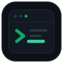

<p align="center">
  
</p>

# chaintable

An experimental command-line client for [Chaintable](https://chaintable.com), the data and compute platform for on-chain applications. Built for coding agents, MCP clients, and terminals, it manages and runs your resources without the web UI; account setup (sign-up, access tokens, members, API keys, variables, and plans) stays on chaintable.com.

*On-chain SQL, live tables, chain state, and BlockX compute — from your terminal, coding agent, or MCP client.*

[](https://github.com/haimingx/chaintable-cli/releases/latest)
[](https://github.com/haimingx/homebrew-tap)
[](https://github.com/haimingx/chaintable-cli/releases)
[](LICENSE)

[Releases](https://github.com/haimingx/chaintable-cli/releases) · [Install](#-install) · [Quickstart](#-quickstart) · [AI Agents](#-ai-agents) · [MCP Server](#-mcp-server) · [Exit Codes](#-output--exit-codes) · [Report an Issue](https://github.com/haimingx/chaintable-cli/issues)

> [!NOTE]
> **Experimental and in active development**: commands and output may change between releases. We improve it from community feedback, so please [open an issue](https://github.com/haimingx/chaintable-cli/issues) for problems and ideas.
>
> Using the Chaintable services through it is governed by the [Chaintable Terms of Service](https://chaintable.com/docs/terms), including the restrictions of your service edition. Data and results are not investment advice.

##  Install

**Homebrew (macOS and Linux):**

```sh
brew install haimingx/tap/chaintable
```

**Shell installer (macOS and Linux):**

```sh
curl -fsSL https://raw.githubusercontent.com/haimingx/chaintable-cli/main/install.sh | sh
```

The installer writes to `~/.local/bin` (override with `CHAINTABLE_INSTALL_DIR`), verifies the archive against `checksums.txt`, and verifies its signature when [cosign](https://docs.sigstore.dev/cosign/system_config/installation/) is installed. Set `CHAINTABLE_VERSION` to install a specific release.

**Windows**: download the `.zip` for your architecture from [Releases](https://github.com/haimingx/chaintable-cli/releases) and put `chaintable.exe` on your `PATH`.

<details>
<summary><strong>Verify a download (Sigstore &amp; SBOM) &amp; shell completion</strong></summary>

`checksums.txt` is signed in the release workflow with [Sigstore](https://www.sigstore.dev/) keyless signing, and each archive includes an SPDX SBOM (`*.sbom.json`):

```sh
cosign verify-blob --bundle checksums.txt.sigstore.json \
  --certificate-identity "https://github.com/haimingx/chaintable-cli-src/.github/workflows/release.yml@refs/tags/<tag>" \
  --certificate-oidc-issuer https://token.actions.githubusercontent.com checksums.txt
sha256sum -c --ignore-missing checksums.txt
```

Shell completion:

```sh
source <(chaintable completion bash)                                     # bash, add to ~/.bashrc
chaintable completion zsh > "${fpath[1]}/_chaintable"                    # zsh
chaintable completion fish > ~/.config/fish/completions/chaintable.fish  # fish
```

</details>

<details>
<summary><strong>Update CLI, plugins &amp; skills</strong></summary>

```sh
chaintable update              # newest release; --version v0.1.0 for a specific one, --check to only look
```

`chaintable update` verifies the download (checksum, and signature when cosign is installed) and replaces the binary in one atomic rename while preserving login and settings. Rerunning the install script does the same. On a terminal, `chaintable` checks GitHub for a newer release at most once a day and prints a notice; it never does in scripts, CI, or agents, and `CHAINTABLE_NO_UPDATE_NOTIFIER=1` turns it off. A binary installed by a package manager is updated with that package manager.

After updating the binary, `chaintable update` brings the skill everywhere it is installed to the new version: it updates the Claude Code and Codex plugins through their own CLIs (`claude`, `codex`; skip with `--no-plugins`) and rewrites skills installed with `chaintable skill install`. Start a new agent session afterwards: a running session keeps the skill it loaded. `chaintable skill sync` does the same for the installed binary.

Without the agents' CLIs on `PATH`, update the plugin inside the agent:

```text
/plugin marketplace update chaintable          # Claude Code, then
/plugin update chaintable@chaintable           # and restart Claude Code
```

```sh
codex plugin marketplace upgrade chaintable    # Codex
```

A plugin does not update a separate copy of the skill in `~/.agents/skills`, `~/.codex/skills`, or `~/.claude/skills`, and the agent loads that copy next to the plugin; `chaintable update` and `chaintable skill sync` name such copies. Delete them when you use the plugin.

</details>

##  What's Included

<table width="100%" style="border-collapse: collapse; border: none;">
  <tr style="border: none;">
    <td width="50%" valign="top" style="border: none; padding: 6px;">
      <h4>Query On-Chain Data with SQL</h4>
      <p style="font-size: 0.9em; line-height: 1.4;">Query indexed blocks, transactions, transfers, tokens, and prices — including state at past blocks.</p>
    </td>
    <td width="50%" valign="top" style="border: none; padding: 6px;">
      <h4>Read Live Tables &amp; Chain State</h4>
      <p style="font-size: 0.9em; line-height: 1.4;">Fetch table rows by key or filter, and read live chain state (balances, code, storage, contract calls) through Leafage.</p>
    </td>
  </tr>
  <tr style="border: none;">
    <td width="50%" valign="top" style="border: none; padding: 6px;">
      <h4>Run Compute &amp; Schedules</h4>
      <p style="font-size: 0.9em; line-height: 1.4;">Build, run, and follow BlockX functions, notebooks, and pipelines on demand or on a schedule without the web UI.</p>
    </td>
    <td width="50%" valign="top" style="border: none; padding: 6px;">
      <h4>Agent &amp; MCP Ready</h4>
      <p style="font-size: 0.9em; line-height: 1.4;">Bundled skill for Claude Code and Codex, local stdio MCP server for Claude Desktop, Cursor, and VS Code, structured JSON output, and documented exit codes.</p>
    </td>
  </tr>
</table>

##  Quickstart

Query commands work without login and read public data. Log in to change resources, run notebooks and schedules, and read the private data of your accounts.

1. Create a personal access token on [chaintable.com](https://chaintable.com).
2. Log in. The token is read without echo and stored in an owner-only file (`~/.config/chaintable/credentials.json`, mode `0600`) that coding agents' sandboxes, CI, and containers can read; pass `--keychain` to keep it in the system keychain instead (which agent sandboxes cannot reach):

   ```sh
   chaintable auth login
   ```

   Commands such as `space create` and `notebook run` need an account. If you belong to several, login lists them and asks which one to use. Inspect status with `chaintable auth status` (`--offline` shows saved state), label a machine with `chaintable auth login --remark "work laptop, token cli-mac"`, and switch accounts with `chaintable account use [name or id]` or `--account-id`. On a terminal, a create or run that uses the selected account first prints `Acting for <account>`.

3. Run commands. They mirror the API as `chaintable <resource> [sub-resource] <action>`:

   ```sh
   chaintable query list --limit 5
   chaintable table get --id token.token_transfer.eth
   chaintable query run --id <query-id> --code @query.sql --wait     # run, wait, print rows
   chaintable notebook run --id <id> --max-cpu 1 --max-memory 2 --follow
   chaintable rpc eth --method getLatestBlock                       # chain name, or numeric id (1)
   chaintable commands                                              # every API command
   chaintable schema query run                                      # inputs of one command
   chaintable api GET '/v1/space/list?limit=5'                      # any endpoint without a command
   ```

<details>
<summary><strong>CI usage, rate limits, User-Agent &amp; token hygiene</strong></summary>

- **CI**: set `CHAINTABLE_TOKEN` and, when you belong to several accounts, `CHAINTABLE_ACCOUNT_ID` instead of logging in. The CLI uses personal access tokens only; API keys are for services that call the API directly and are billed to their account.
- **Billing &amp; rate limits**: CLI calls are not billed; they are rate limited per IP address. `chaintable auth status` checks the token against the API; `--offline` shows the saved state.
- **User-Agent**: each request sends `chaintable-cli/<version> (<os>/<arch>; <caller>)` for usage statistics. `<caller>` is the AI agent running the CLI when its environment variables name one (`claude-code`, `codex`, ...), `ci` in CI, or `interactive` / `noninteractive` depending on whether stdin is a terminal. Nothing else about you, your machine, or your commands is sent.
- **Token hygiene**: a coding agent can read anything the CLI can, so treat the token on an agent's machine as exposed to it. Give each machine its own token with a short expiry, and revoke it on chaintable.com when no longer needed. The bundled skill instructs agents never to read or print the token, and the Claude Code permissions below block reading the credentials file.

</details>

##  AI Agents

### Claude Code

Install the CLI first (see [Install](#-install)), then install the plugin:

```text
/plugin install chaintable --marketplace haimingx/chaintable-cli
```

On Claude Code before 2.1.275, run `/plugin marketplace add haimingx/chaintable-cli` and then `/plugin install chaintable@chaintable`. To update, see **Update CLI, plugins & skills** under [Install](#-install).

Then ask in plain language — for example, *"How many USDC transfers happened on Ethereum yesterday?"*. Log in yourself with `! chaintable auth login` so the agent never sees the token.

When the plugin's skill is in use, read-only commands such as `table get` and `query list` run without a prompt; creates, runs, updates, and deletes still ask. To allow read-only commands in every turn and keep Claude Code from reading the token file, add the settings printed by `chaintable skill print references/permissions.md` to `~/.claude/settings.json`. With the Bash sandbox on, allow network access to the API host.

### Codex

```sh
codex plugin marketplace add haimingx/chaintable-cli
codex plugin add chaintable@chaintable
```

If a `chaintable` skill is also in `~/.codex/skills` or `~/.agents/skills`, delete that copy so the plugin's skill is the only one loaded.

Codex's sandbox blocks network access by default. Enable it in `~/.codex/config.toml`:

```toml
sandbox_mode = "workspace-write"

[sandbox_workspace_write]
network_access = true
```

### Other Agent Skills clients

Agents that read [Agent Skills](https://agentskills.io) without a plugin system can install the bundled skill directly from the binary into the shared user directory or a project:

```sh
chaintable skill install ~/.agents/skills      # or .agents/skills in a project
```

`chaintable update` keeps it synced to the binary version.

##  MCP Server

`chaintable mcp` is a local [MCP](https://modelcontextprotocol.io) server for clients such as Claude Desktop, Cursor, and VS Code. The client launches it over stdio and requests go straight from your machine to the Chaintable API. Coding agents that run shell commands, such as Claude Code and Codex, are better served by the plugin above.

1. Install the CLI (`>= 0.4.0`; see [Install](#-install)).
2. Optional: run `chaintable auth login` in a terminal. Without login the server reads public data; with it, it also reads your accounts' private data and can create and run resources. No token goes into the client configuration.
3. Desktop apps do not read your shell `PATH`, so pass the binary's full path: `chaintable mcp --help` prints a ready configuration (or run `which chaintable`; on Windows, `where chaintable`).
4. Add the server to your client, then restart the client fully.

**Claude Desktop** (`claude_desktop_config.json` via Settings → Developer → Edit Config; macOS: `~/Library/Application Support/Claude/`, Windows: `%APPDATA%\Claude\`) & **Cursor** (`~/.cursor/mcp.json` or project `.cursor/mcp.json`):

```json
{
  "mcpServers": {
    "chaintable": {
      "command": "/Users/you/.local/bin/chaintable",
      "args": ["mcp"]
    }
  }
}
```

<details>
<summary><strong>VS Code, Claude Code, Windows paths &amp; profile selection</strong></summary>

**VS Code** (`.vscode/mcp.json` or command *MCP: Add Server*):

```json
{
  "servers": {
    "chaintable": {
      "type": "stdio",
      "command": "/Users/you/.local/bin/chaintable",
      "args": ["mcp"]
    }
  }
}
```

**Claude Code** (when you prefer MCP over the plugin):

```sh
claude mcp add --scope user chaintable -- chaintable mcp
```

- **Windows**: use the full path to `chaintable.exe` with escaped backslashes (`"C:\\Tools\\chaintable.exe"`).
- **Profiles**: add `"env": {"CHAINTABLE_PROFILE": "work"}` to the server entry.
- **Security**: never put `CHAINTABLE_TOKEN` in a client configuration file — those files are plain text and often synced or shared.

</details>

### Tools

| Tool | Runs | Approval |
| :--- | :--- | :--- |
| `chaintable_read` | Read-only commands: SQL and table reads, chain calls, getting and listing resources, `commands`, `schema`, `skill print` | Marked read-only; safe to allow always |
| `chaintable_run` | Commands that create, change, delete, or run something | Keep asking each time; deletes also need `--yes` |

Both take the arguments after `chaintable` as a list, e.g. `["table", "get", "--id", "token.token.eth"]`. The model is instructed to read the skill first via `["skill", "print"]`. Login, `update`, `skill sync`, and other CLI management commands run only in a terminal, and `--base-url` is refused so no text the model reads can redirect your token. Results over 80 KB are refused with a hint to narrow the query (`LIMIT`, `--limit`, `--fields`, or `--start`), since clients cap tool results and may not read local files.

<details>
<summary><strong>MCP troubleshooting</strong></summary>

| Symptom | Check |
| :--- | :--- |
| The tools do not appear | Restart the client fully; verify the `command` path with `"<path>" version` in a terminal |
| `spawn chaintable ENOENT` or command not found | Use the absolute binary path from step 3 |
| `this command requires login` | Run `chaintable auth login` in a terminal; the server picks it up on the next call |
| Calls fail with network errors | Confirm the machine can reach `api.chaintable.com` |
| Anything else | Run `chaintable mcp` in a terminal (it waits silently for a client; stop with Ctrl-C). Claude Desktop logs live in `~/Library/Logs/Claude/mcp*.log` (Windows: `%APPDATA%\Claude\logs`) |

</details>

##  Output & Exit Codes

Output defaults to a table on a terminal and JSON otherwise; use `-o ndjson` for rows, `--fields` to trim columns, and `--out <file>` for large results. On a terminal, errors print `Error:` and `Hint:` lines; otherwise the last `stderr` line is a JSON error report.

| Exit code | Meaning |
| :--- | :--- |
| `0` | Success |
| `1` | Ran but failed (query error, failed function or notebook) |
| `2` | Usage error or rejected input |
| `3` | Not logged in or invalid credential |
| `4` | No permission or wrong account |
| `5` | Not found |
| `6` | Conflict |
| `7` | Rate limited |
| `8` | Network or server error (retryable; `GET` requests are already retried twice) |
| `9` | `--wait` or `--follow` timed out |

##  Feedback & Security

Report bugs and request features in [Issues](https://github.com/haimingx/chaintable-cli/issues). Include `chaintable version` and the `request_id` from the error — never include a token. The source is not public, so pull requests are not accepted.

Report vulnerabilities privately as described in [SECURITY.md](SECURITY.md).

##  License

Free to use under the terms in [LICENSE](LICENSE), which cover this software only; third-party components are listed in [THIRD_PARTY_NOTICES](THIRD_PARTY_NOTICES).
